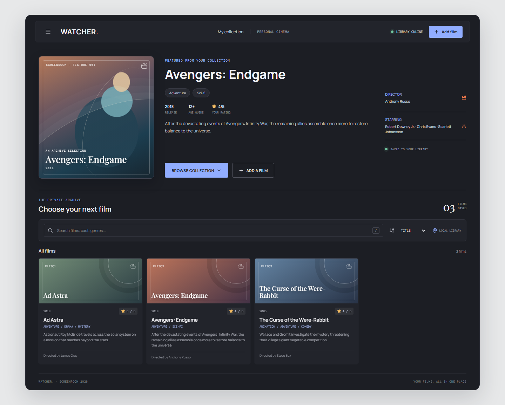
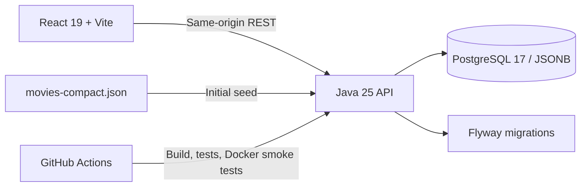

# Watcher | Movie Library

**A personal cinema for the films you want to remember.** Watcher is a full-stack movie library with a React interface, a Java 25 REST API, and PostgreSQL-backed persistence. Browse, search, sort, and add films through a responsive interface; run the entire product with Docker Compose.



## Product Overview

- Browse a featured film with its poster treatment, synopsis, genres, director, cast, and personal rating.
- Search the collection across movie details and sort by title, release year, or rating.
- Add films through a validated form; records persist in PostgreSQL as JSONB.
- Import `movies-compact.json` once when the database is empty.

## Architecture



### Technology

| Area | Tools |
| --- | --- |
| Frontend | React 19, Vite 8, Lucide |
| API | Java 25, JDK `HttpServer`, Jackson |
| Persistence | PostgreSQL 17, JSONB, JDBC, Flyway |
| Delivery | Multi-stage Docker build, Docker Compose, GitHub Actions |
| Maintenance | Dependabot for Maven, npm, and GitHub Actions |

## Quick Start

Requirements: Docker Engine with Compose. Copy the sample environment file and replace the placeholder with a random local password; `.env` is ignored by Git.

```powershell
Copy-Item .env.example .env
```

From the `Movie` directory, build and start the API and database:

```sh
docker compose up --build --detach --wait
```

Open **http://localhost:8080/**. Docker Compose persists database data in the `movie-data` volume. To reset the local database and re-import the JSON seed, run `docker compose down --volumes` before starting the stack again.

## Development

Requirements: Java 25, Maven, Node 22.23.3 (`web/.nvmrc`), and Docker Compose.

1. Start PostgreSQL and configure the API password in the backend terminal:

```powershell
docker compose up -d postgres
$env:DB_PASSWORD = "your local .env password"
mvn test
mvn exec:java
```

2. In a second terminal, start the React development server with hot reload and an API proxy:

```powershell
Set-Location web
npm ci
npm run dev
```

Open **http://127.0.0.1:5173/**. For the production bundle and complete verification, run `mvn --batch-mode clean verify`; Maven installs the pinned Node runtime, builds React into `web/dist`, packages those assets with the Java app, and runs the tests.

## Operations

- `GET /health/live` checks process liveness.
- `GET /health/ready` checks PostgreSQL readiness.
- `GET /api/movies` lists films; `GET /api/movies?q=arrival` searches.
- `POST /api/movies` adds a JSON object with a non-empty `name`.
- Flyway applies versioned schema migrations and baselines the existing v1 schema without dropping movie data.
- GitHub Actions runs Maven verification, starts PostgreSQL and the API, checks migrations, tests API persistence across a restart, and verifies the legacy-schema upgrade path.

The `.env.example` password is a placeholder for local use only. Use managed secrets and a managed database outside local development.

## License

The application code is licensed under the MIT License; see [LICENSE](LICENSE). The `movies-compact.json` sample dataset is excluded from that license and remains subject to its own source and redistribution terms.

<details>
<summary>Original assignment brief</summary>

### Tehtävänanto

Suunnittele ja toteuta API-backend, jota vasten API-client voi hakea elokuvia ja hallita niiden tietoja.

## Vaatimukset

- Valitse yleisessä käytössä oleva protokolla, jolla client voi keskustella API:n kanssa, esimerkiksi HTTP tai GraphQL.
- Älä toteuta API-clientia itse, vaan käytä jotain avoimen lähdekoodin clientia.
- Toteuta backend Java Virtual Machinen päälle, esimerkiksi Java-kielellä.
- Backendin ja API:n design on vapaasti valittavissa.
- Datan tallentamiseen riittää staattinen `movies-compact.json`-tiedosto (katso liitetiedosto), mutta voit käyttää myös oikeaa tietokantaa, esimerkiksi MongoDB:tä tai PostgreSQL:ää Dockerissa.
- API-clientin kirjautumista ja pääsynhallintaa ei tarvitse huomioida.

## API:n käyttötapaukset

Toteuta niin paljon kuin haluat tai ehdit:

1. Listaa kaikki elokuvat. Listauksessa voi näyttää elokuvien oleelliset tiedot.
2. Hae elokuvat, jotka osuvat clientin hakutermiin.
3. Lisää tietokantaan uusi elokuva ja sen tiedot.

## Backendin käynnistys

Tarvitset Java 25:n (LTS), Mavenin ja Docker Composen. Ohjeet englanniksi ovat tämän README-tiedoston alussa.

Backend käyttää Dockerissa ajettavaa PostgreSQL:ää tietojen tallentamiseen. `movies-compact.json` tuodaan tietokantaan backendin ensimmäisellä käynnistyksellä, jos tietokanta on tyhjä. Myöhemmillä käynnistyksillä käytetään tietokannan sisältöä eikä JSON-tiedostoa tuoda uudelleen.

Käynnistä API ja PostgreSQL projektin juurihakemistossa:

```sh
docker compose up --build --detach --wait
```

Tietokantayhteyden asetukset määritellään `.env`-tiedostossa. Vaihda esimerkkitiedoston salasanapaikkamerkki satunnaiseen paikallisen kehityksen salasanaan. `.env` ohitetaan Gitissä. API käyttää oletuksena porttia `8080`; portin voi vaihtaa `APP_PORT`-muuttujalla.

API:n osoite on `http://localhost:8080/api/movies`:

- `GET /api/movies` listaa elokuvat.
- `GET /api/movies?q=arrival` hakee elokuvia hakutermillä kaikista elokuvan tiedoista.
- `POST /api/movies` lisää elokuvan. Lähetä JSON-olio, jossa on vähintään ei-tyhjä `name`-kenttä. Muut kentät tallennetaan sellaisinaan.

Lisäykset tallentuvat PostgreSQL:ään. Docker Compose säilyttää tietokannan `movie-data`-volumessa.

---

### Assignment

Design and implement an API backend that an API client can use to retrieve movies and manage their information.

## Requirements

- Choose a widely used protocol for communication between the client and API, such as HTTP or GraphQL.
- Do not implement the API client yourself; use an open-source client.
- Implement the backend on the Java Virtual Machine (JVM), for example using Java.
- The backend and API design are your choice.
- A static `movies-compact.json` file (see the attachment) is sufficient for storing data. You may also use a real database, such as MongoDB or PostgreSQL running in Docker.
- You do not need to implement API-client authentication or access control.

## API use cases

Implement as many of these as you want or have time for:

1. List all movies. The list may show the movies' key information.
2. Search for movies that match the client's search term.
3. Add a new movie and its information to the database.

## Running the backend

Java 25 (LTS), Maven, Docker Engine, and Docker Compose are required.

The backend uses PostgreSQL running in Docker for persistent storage. On its first start with an empty database, `movies-compact.json` is imported. Later starts use the database contents and do not import the file again.

Start the API and PostgreSQL from the project root:

```sh
docker compose up --build --detach --wait
```

Database settings are configured in `.env`. Replace the sample password placeholder with a random local-development password; `.env` is ignored by Git. The API listens on port `8080` by default; set `APP_PORT` to use a different host port.

The API is available at `http://localhost:8080/api/movies`:

- `GET /api/movies` lists all movies.
- `GET /api/movies?q=arrival` searches across each movie's data.
- `POST /api/movies` adds a movie. Send a JSON object with at least a non-empty `name` field; other fields are stored as provided.

Added movies are saved to PostgreSQL. Docker Compose persists the database in the `movie-data` volume.

</details>
